<!-- Source of presentation.pdf. Build with: python build.py. Speaker notes are the HTML
     comments under each slide. Five-minute pitch in French: eight slides, then backups.
     Numbers on the slides sit in generated figures; the ones in the notes are re-checked
     against the notebook at the freeze. -->

# Même dossier, autre région, autre réponse

## À cote R égale, les régions éloignées reçoivent moins.

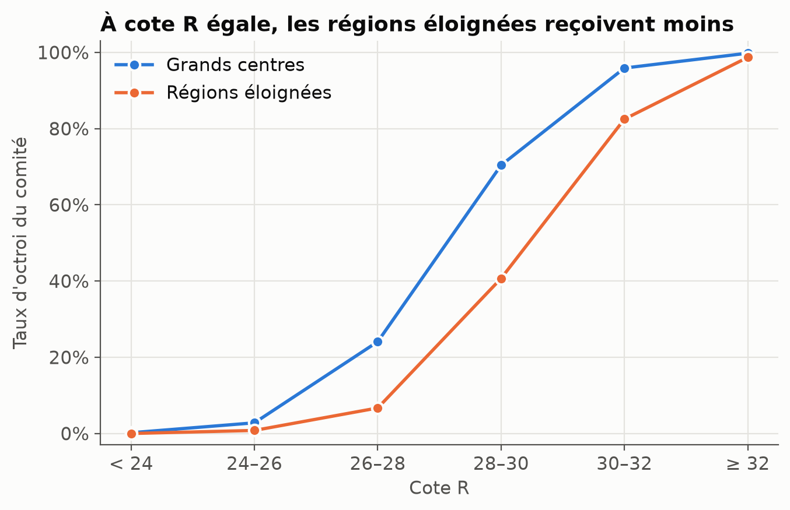

<!--
Notes (35 s).
Le comité accordait une bourse à près d'un candidat sur deux dans les grands centres,
contre à peine plus d'un sur quatre dans les régions éloignées. On pourrait croire à une
différence de dossiers. Ce n'est pas le cas : à cote R égale, dans chaque tranche, la
courbe orange reste sous la courbe bleue. Le modèle en production, exact à 88 %, a appris
ces décisions : être exact, ici, c'est être fidèle à une décision biaisée.
-->

---

# Un écart, deux biais

## Le comité se résume à quatre poids. Deux sont des biais.

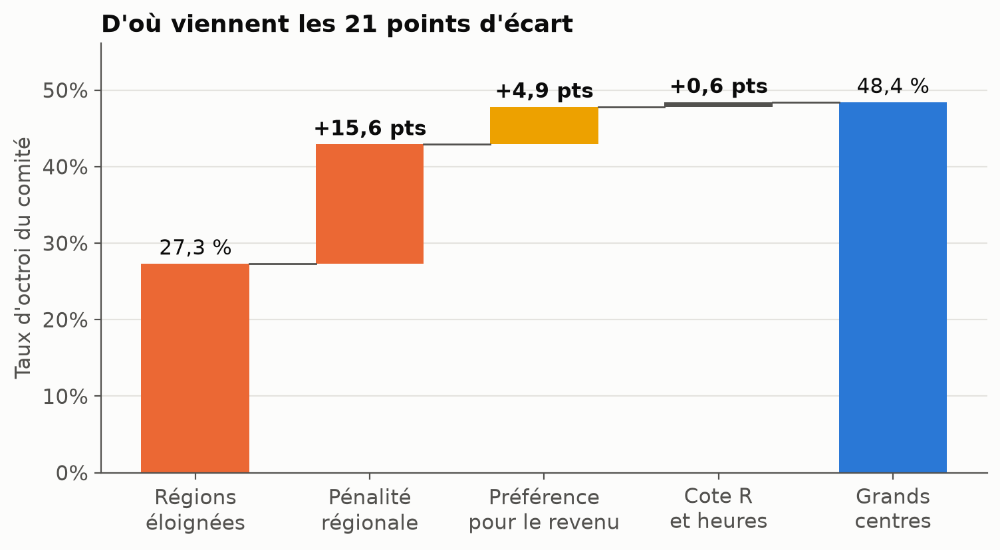

<!--
Notes (40 s).
Nous avons modélisé le comité lui-même. Quatre éléments suffisent à le décrire : la cote
R, les heures travaillées, le revenu, et une pénalité constante pour les régions
éloignées, qui vaut à elle seule 1,4 point de cote R. Cette pénalité explique les trois
quarts de l'écart. Le reste vient d'un second biais, indirect : le comité favorisait les
revenus élevés, et les familles des régions éloignées gagnent moins. La cote R, elle,
n'explique presque rien : les candidats des régions travaillent plus, et le comité
récompensait le travail.
-->

---

# Retirer la région ne suffit pas

## Le biais ne disparaît pas : il change de colonne.

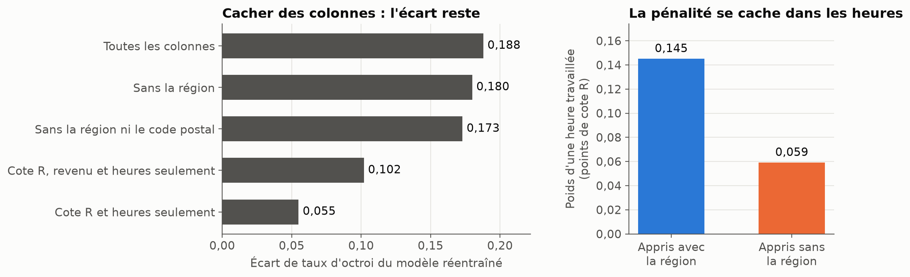

<!--
Notes (35 s).
Le réflexe est de cacher la région. À gauche : on retire la région, puis le code postal,
l'écart ne bouge presque pas. La distance et le code postal redonnent la région. À droite,
le mécanisme, et c'est notre résultat le plus important : quand le modèle ne voit plus la
région, il explique les refus par ce qui distingue ces candidats. Ils travaillent plus,
donc il apprend que les heures comptent moins. La pénalité s'est cachée dans le poids
d'une colonne qui a l'air neutre.
-->

---

# Notre correction : apprendre le biais pour le retirer

## La région sert à apprendre, jamais à décider.

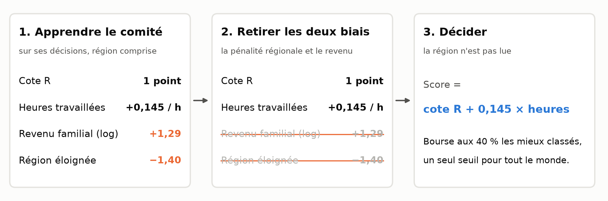

<!--
Notes (35 s).
D'où notre méthode, en trois temps. Un : on réapprend le comité avec la région, pour que
la pénalité soit attribuée à la région et que chaque autre poids soit juste. Deux : on
retire les deux biais, la pénalité et la préférence pour le revenu. Trois : il reste une
règle d'une ligne, la cote R plus les heures travaillées, avec un seul seuil pour tout le
monde. Deux candidats de même dossier reçoivent la même réponse, où qu'ils habitent. Et
on peut l'expliquer exactement à un candidat refusé.
-->

---

# Comment nous l'avons trouvée

## L'étalon est caché : des modèles complets, quatre familles, un arbitre.

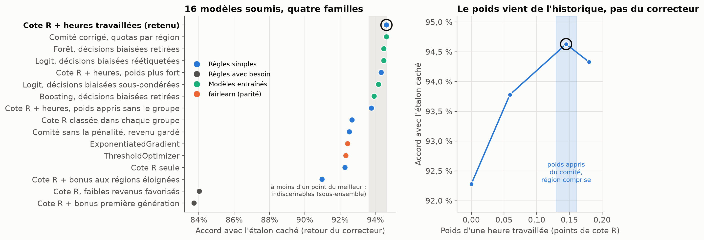

<!--
Notes (45 s).
Comment savoir que c'est la bonne règle, quand l'étalon du jury est caché ? Nous avons
formulé des hypothèses sur le mérite, construit quatre familles de modèles, et soumis
seize fichiers, chacun un vrai modèle dans le budget. À gauche : notre règle arrive en
tête. Les modèles entraînés, forêts, boosting, convergent vers elle sans la dépasser :
il n'y a rien d'autre à apprendre. Les règles fondées sur le besoin sont loin. La parité
imposée par fairlearn fait deux points de moins. À droite, le point de rigueur : le poids
des heures vient de l'historique, pas du correcteur. Nous n'avons réglé aucun paramètre
sur ces retours ; il se trouve que le poids appris est là où l'accord est le plus haut.
-->

---

# Le compromis équité–utilité

## S'éloigner du comité est voulu : le désaccord, ce sont les décisions biaisées.

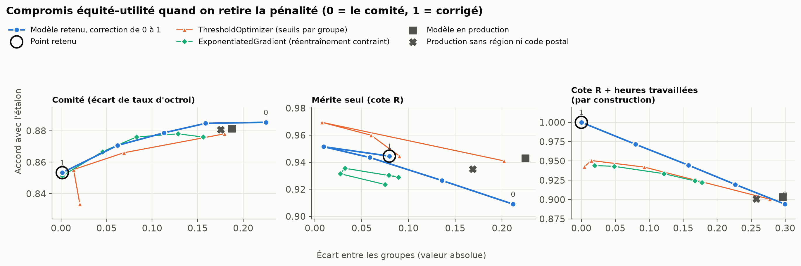

<!--
Notes (35 s).
Le front de Pareto : on retire la pénalité de zéro à cent pour cent. À gauche, contre le
comité : l'écart tombe à zéro et on perd environ trois points d'accord avec lui. Ce
désaccord, ce sont précisément les décisions biaisées. Au centre et à droite, contre deux
étalons de mérite : l'écart d'égalité des chances se referme, sous l'hypothèse la moins
favorable comme sous la plus probable. Les méthodes de fairlearn sont sur la figure : même
équité, moins d'accord, et l'une d'elles décide en lisant la région. Le budget est tenu
exactement, quarante pour cent, et les cinq régions se rejoignent autour de ce taux.
-->

---

# En production

## Surveiller le biais lui-même, pas seulement ses symptômes.

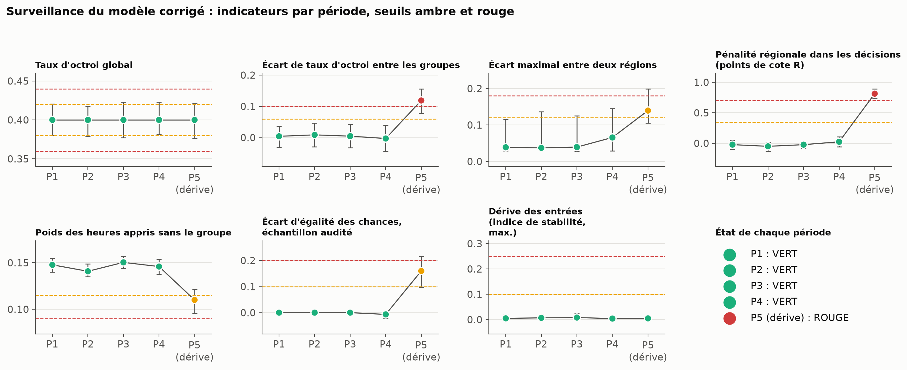

**Mesuré** : la pénalité réapprise à chaque cycle, un échantillon réexaminé à l'aveugle. **Alerte rouge** : le comité d'équité peut suspendre le modèle. **Recours** : explication exacte, révision humaine.

<!--
Notes (40 s).
Notre prototype de surveillance tourne. Il rejoue quatre périodes normales, puis une
cinquième où une version à moitié corrigée est déployée par erreur : elle passe au rouge.
Deux indicateurs sont nouveaux. La pénalité régionale, réapprise à chaque cycle sur les
décisions : c'est le biais mesuré directement. Et le poids des heures appris sans la
région : il baisse dès qu'une pénalité se cache. Enfin, le système ne voit que ses
propres décisions ; un échantillon est donc réexaminé à l'aveugle par un panel
indépendant. Côté candidat : il est informé, il reçoit une explication et il peut demander une
révision humaine ; notre règle d'une ligne rend l'explication exacte.
-->

---

# Limites et décisions à prendre

## Ce que nous ne savons pas, et ce qui revient à l'institution.

### Ce que nous ne savons pas

- L'étalon du mérite reste une hypothèse, appuyée par des retours sur un sous-ensemble.
- Les données sont synthétiques : un vrai comité est moins régulier.
- Près du seuil, aucune règle ne départage bien : ces dossiers vont à un réviseur.

### Ce que l'institution doit décider

- Les **heures travaillées** comptent-elles comme du mérite ? Effort, ou contrainte ?
- Faut-il un critère de **besoin** ? Le modèle n'en introduit pas de lui-même.
- Le **coût** est réel : à budget fixe, des candidats des grands centres perdent.

<!--
Notes (35 s).
Nous terminons par ce que nous ne savons pas. L'étalon reste une hypothèse. Les données
sont synthétiques. Et près du seuil, aucune règle n'est fiable : ces dossiers vont à un
humain. Surtout, trois décisions ne sont pas techniques. Les heures travaillées sont-elles
du mérite ? Faut-il tenir compte du besoin ? Et qui supporte le coût, puisque le budget
est fixe ? Notre modèle rend ces choix visibles ; il ne les prend pas à la place de
l'institution. Merci.
-->

---

# Annexe : avant et après, par région

## Le budget est tenu, et les cinq régions se rejoignent.

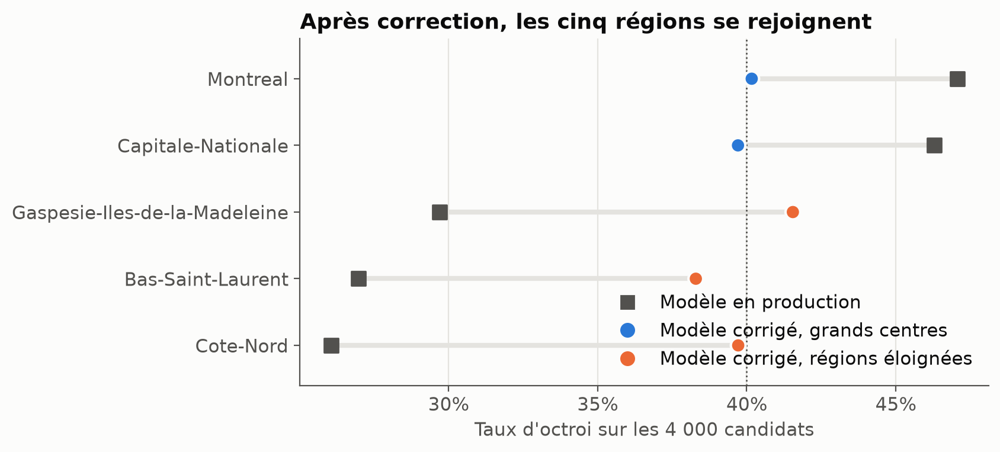

---

# Annexe : ce que le comité a pesé

## Une pénalité constante, la même dans les trois régions éloignées.

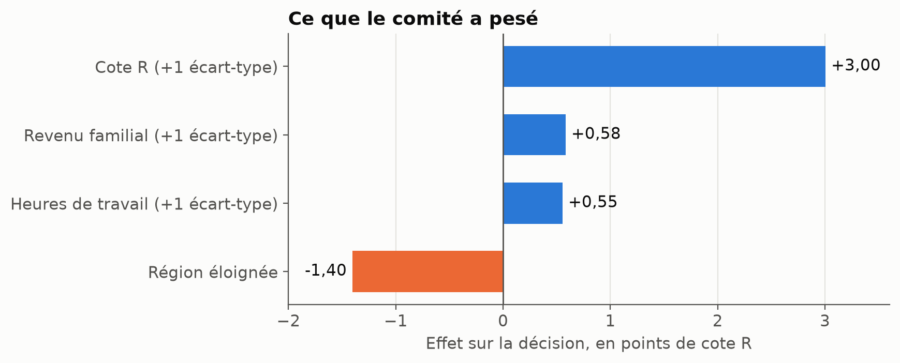

---

# Annexe : les colonnes qui trahissent la région

## Le code postal et la distance la donnent presque à coup sûr.

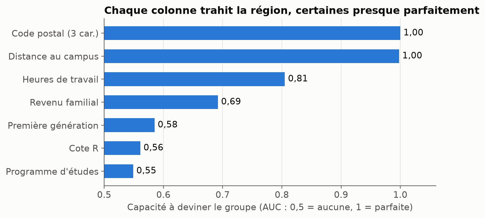

---

# Annexe : le modèle en production

## Il reproduit l'écart du comité sur les nouveaux candidats.

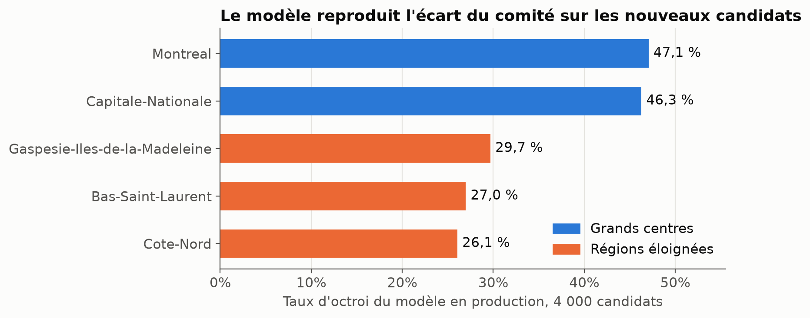

---

# Annexe : le front de Pareto complet

## Un panneau par hypothèse sur l'étalon du mérite.

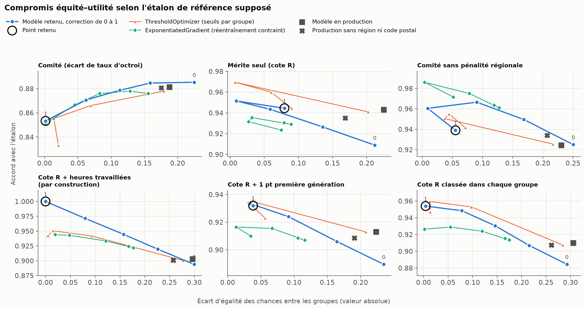

---

# Annexe : méthode

- **Sous-groupes** (première génération, revenu, heures, programme) : rapport d'audit, section 7.
- **Reproductibilité** : `python build.py` reconstruit tous les livrables ; chaque essai est une spécification rejouable (`experiments/`, `runs/ledger.csv`) ; chaque fichier soumis est conservé (`submissions/`).
- **Détail de la gouvernance** : `gouvernance.md` ; prototype : `monitoring.py`.

